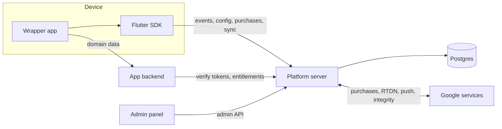

# Apps Platform

A reusable foundation for Flutter mobile apps.

Every mobile product needs the same set of systems under the hood:
user accounts, offline data sync, event tracking, remote config and
A/B tests, subscriptions, ad monetization, attribution, push
notifications and analytics. This repository builds them once, so
every new app only adds its own screens and domain data.

A new app is not a new deployment: it is a new `app_id` registered
in the admin panel. One platform server serves all apps.

## How it works

The platform is one data loop:

1. **Acquisition.** An ad brings a user, the install source is recorded.
2. **Device.** The SDK creates an anonymous account, stores data
   offline, records user actions as events.
3. **Backend.** The platform server stores events, assigns experiment
   variants, verifies purchases, schedules pushes.
4. **Analysis.** Dashboards show retention, conversion and revenue
   per cohort and per experiment variant.

Decisions flow back into the app through remote config, experiment
variants and pushes. Ad networks are told which users turned out to
be valuable.

## Architecture



| Component       | Role                                                        |
|-----------------|-------------------------------------------------------------|
| Flutter SDK     | Lives inside every app: auth, local DB, event queue, config, billing, push |
| Platform server | Shared backend for all apps: stores data, makes decisions   |
| Admin panel     | Manage apps, config, experiments, pushes; view dashboards   |
| App backend     | Per-app domain logic and data, not part of this repo        |
| Google services | Play Billing, Play Developer API, Pub/Sub, FCM, Play Integrity |

### Data separation

- **Platform database:** users, sessions, events, config, experiments,
  subscriptions, attribution, push tokens, decision logs.
  One database for all apps, every row carries an `app_id`.
- **App databases:** domain data of each app, owned by its own backend.
- The only link between them is `user_id` (UUID). No cross-database
  foreign keys.

## Systems (stage 0)

| # | System                    | What it does                                                   | Status  |
|---|---------------------------|----------------------------------------------------------------|---------|
| 1 | Identity                  | Anonymous accounts, Google sign-in linking, access/refresh tokens | Planned |
| 2 | Event tracking            | Typed events from a tracking plan, batched ingestion, validation | Planned |
| 3 | Offline-first sync        | Local SQLite, outbox, cursor-based pull, per-field conflict resolution | Planned |
| 4 | Remote config & A/B tests | Config with defaults, hash-based assignment, layers, global holdout, kill switches | Planned |
| 5 | Subscriptions             | Play Billing, server-side verification, RTDN, entitlements      | Planned |
| 6 | Attribution               | Install Referrer, server-side conversion events to ad networks  | Planned |
| 7 | Push notifications        | FCM tokens, templates, scheduling, weekly budget, delivery logs | Planned |
| 8 | Dashboards & alerts       | Cohort retention, funnels, user states, Telegram alerts         | Planned |
| 9 | Protection & engagement   | Play Integrity, streaks, in-app review, ad frequency rules      | Planned |

Cross-cutting: decision logging, crash reporting, GDPR consent,
account deletion.

## Tech stack

| Layer           | Choice                       | Why                                              |
|-----------------|------------------------------|--------------------------------------------------|
| Mobile SDK      | Dart, Flutter, drift (SQLite) | Offline-first local storage, one SDK for every app |
| Platform server | Node.js, Fastify, TypeScript | Long-running workers, high-volume ingestion, type safety for events and money |
| Database        | Postgres, Drizzle ORM        | Reliable, typed schema and migrations            |
| Background jobs | pg-boss                      | Job queue inside Postgres, no Redis needed       |
| Admin panel     | Next.js, JavaScript          | Management UI and built-in charts                |
| Deployment      | Docker Compose, Caddy        | Single VPS, automatic HTTPS                      |
| Crash reporting | Firebase Crashlytics         | Free, native Flutter support                     |

## Repository structure

```
platform/        Platform server (Fastify)
admin/           Admin panel (Next.js)
sdk/flutter/     Flutter SDK package
tracking-plan/   Event schema and code generator
packages/        Shared JS packages
infra/           Docker Compose, Caddyfile, env template, backup scripts
docs/            Architecture notes and decision records (docs/adr/)
```

## Deployment

Four containers on a single VPS:

- `postgres` — platform database, not exposed to the internet
- `platform` — API server and background worker
- `admin` — admin panel, reachable only through VPN
- `caddy` — reverse proxy with automatic HTTPS, the only public entry point

External services (Google, Crashlytics) run in their own clouds and are
reached over HTTPS; they need credentials, not containers.

## Security principles

- Everything inside the app binary is public. No secrets in the app.
- Everything coming from a device is untrusted and validated against a schema.
- `app_id` is taken from the signed token, never from the request body.
- Purchases and ad rewards are verified on the server.
- Short-lived access tokens, rotating refresh tokens stored as hashes.
- Secrets live in `.env` on the server and never enter git.
- The admin panel sits behind VPN and two-factor auth; admin actions are audit-logged.
- Collect the minimum personal data; account deletion removes the user everywhere.

## Principles

- `user_id` never changes, even after signing in with Google.
- The server is the source of truth, especially for money.
- Events are the raw material for all metrics and experiments.
- Every system decision (variant, push, offer) is logged.
- Platform data and app data are stored separately, linked only by `user_id`.

## Roadmap

Stages are switched by data volume, not by calendar.

- **Stage 0 — launch.** Collect data correctly, never lose payments.
- **Stage 1 — steady flow.** Statistical layer for experiments (sequential
  tests, CUPED, SRM checks, guardrails), rule-based pLTV, push bandit.
- **Stage 2 — noticeable audience.** Feature store, gradient boosting
  models for churn and LTV, contextual bandits.
- **Stage 3 — large scale.** Uplift models, reinforcement learning, user embeddings.

## Conventions

- All code comments and docs are in English.
- Commits follow [Conventional Commits](https://www.conventionalcommits.org/)
  (`feat:`, `fix:`, `docs:`, `chore:`).
- Work happens in feature branches, merged into `main`.
- Major decisions are recorded as ADRs in `docs/adr/`.

## Getting started

Not yet available: setup instructions will appear with the first runnable part.

## Status

Stage 0: repository skeleton.