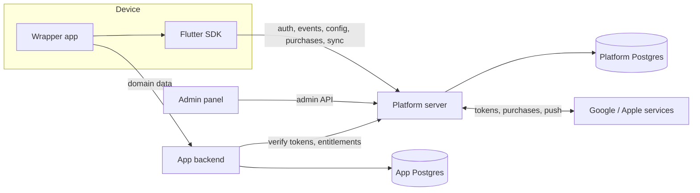

# Architecture

Apps Platform is a reusable foundation for Flutter mobile apps. Every mobile
product needs the same systems under the hood: accounts, offline sync, event
tracking, remote config and A/B tests, subscriptions, attribution, push
notifications and analytics. This repository builds them once. A wrapper app
plugs in the SDK and adds only its own screens and domain data.

## Components



| Component       | Location        | Role |
|-----------------|-----------------|------|
| Flutter SDK     | `sdk/flutter/`  | Lives inside every app: auth, local storage, event queue, config, billing, push |
| Platform server | `platform/`     | One backend for all apps: stores platform data, makes decisions |
| Admin panel     | `admin/`        | Manage apps, config, experiments, pushes; dashboards and charts |
| App backend     | separate repo   | Domain logic and data of one app; trusts platform access tokens |
| External        | vendor clouds   | Google / Apple sign-in, Play Billing, FCM, Play Integrity; reached over HTTPS, not containers |

## Apps, platforms and users

- **One platform server serves all apps.** An app is a row in `apps.apps`.
  Adding an app means registering it, not deploying anything.
- **One `app_id` per product across Android and iOS.** The platform is a
  dimension, not a separate app. It is recorded on every installation, carried
  in every access token (`plt`), and will be stored on every event and
  subscription. A person who moves from Android to iPhone and signs in with the
  same Google account stays one user, while all statistics can still be split
  by platform.
- **Users are per app.** The same person in two apps is two users. They can be
  correlated later through the provider account id: Google's `sub` is the same
  across all apps, Apple's `sub` is the same within one developer team.

## Data separation

- **Platform database**: users, installations, sessions, consents, and later
  events, config, experiments, subscriptions, push tokens, decision logs.
  One database for all apps; every row carries an `app_id`.
- **App databases**: domain data of each app, owned by that app's backend.
- The only link between them is `user_id` (UUID). No cross-database foreign keys.

Inside the platform database each module has its own Postgres schema
(`apps`, `identity`, later `events`, `config`, ...).

Tables that belong to a user reference the pair `(user_id, app_id)` through a
composite foreign key. The database itself refuses rows that would mix data of
two apps.

Operational data is normalized. Analytical event data will be denormalized on
purpose: every event carries its context (platform, app version, experiment
variants), because joining millions of rows on every chart is too slow.

## Platform server structure

The server is a **modular monolith**: one process, split into modules that do
not reach into each other's tables.

```
platform/
  src/
    core/              config, database, errors, shared column helpers
    modules/
      apps/            schema.ts, service.ts
      identity/        schema.ts, service.ts, routes.ts, tokens.ts, ...
    app.ts             builds the Fastify instance (used by tests)
    server.ts          starts it, owns process lifecycle and the DB pool
  migrations/          generated SQL migrations, committed
  scripts/             key generation, dev seed
  test/                test setup and helpers
```

Rules:

- A module owns its tables. Other modules call its service functions and never
  query its tables directly. Importing its enums and types is allowed.
- Each module exposes its routes as a Fastify plugin registered in `app.ts`.
- `app.ts` only builds the app. `server.ts` starts it, handles SIGINT/SIGTERM
  with graceful shutdown and closes the database pool.

## Request handling

- **Validation.** Route schemas are written in zod (via
  `fastify-type-provider-zod`). Invalid requests are rejected before handler
  code runs. Response schemas strip any field that is not declared.
- **Errors.** Every error response has the shape `{ "error": "<code>",
  "message": "<text>" }`. Expected errors are thrown as `AppError` with an HTTP
  status and a stable code. An optional internal reason is logged and never
  sent to the client. Anything unexpected becomes `500 internal_error` with
  details only in the log.
- **Authentication.** Protected routes declare `preHandler: requireAuth`, which
  verifies the access token and exposes its claims as `request.auth`.
- **Rate limits.** Opt-in per route through `config.rateLimit`.
- **Health.** `GET /health` returns `{ status: "ok", database: "ok" }`, or
  `503` when the database is unreachable.

## Tech stack

| Layer           | Choice                          | Why |
|-----------------|---------------------------------|-----|
| Mobile SDK      | Dart, Flutter                   | One SDK for every app |
| Platform server | Node.js 24, Fastify, TypeScript | Long-running workers, high-volume ingestion, types for events and money |
| Database        | Postgres 18, Drizzle ORM        | Typed schema, generated migrations, native `uuidv7()` |
| Validation      | zod                             | One schema language for env, requests and responses |
| Tokens          | jose                            | JWT signing and verification, remote JWKS, no dependencies |
| Background jobs | pg-boss (planned)               | Job queue inside Postgres, no Redis |
| Admin panel     | Next.js, JavaScript             | Management UI and built-in charts |
| Tests           | Vitest against real Postgres    | Constraints, locks and transactions are tested for real |
| Deployment      | Docker Compose, Caddy           | Single VPS, automatic HTTPS |

## Deployment (planned)

Four containers on a single VPS:

- `postgres`: platform database, not exposed to the internet
- `platform`: API server and background worker
- `admin`: admin panel, reachable only through VPN
- `caddy`: reverse proxy with automatic HTTPS, the only public entry point

Behind Caddy the server must take the client IP from the proxy header,
otherwise all users share one IP and one rate limit bucket.

## Security principles

- Everything inside the app binary is public. No secrets in the app.
- Everything coming from a device is untrusted and validated against a schema.
- `app_id` is taken from the signed token, never from the request body.
- Purchases and ad rewards are verified on the server.
- Short-lived access tokens; rotating refresh tokens stored as hashes.
- Secrets live in `.env` on the server and never enter git.
- Clients get one error code per category; specific reasons go to the log.
- The admin panel sits behind VPN and two-factor auth; admin actions are audit-logged.

## Privacy and consent

- Consent is recorded **per purpose**: `ads`, `analytics`, `personalization`.
- Each app has **regional policies** (`apps.consent_policies`): `none` (no
  screen), `optional` (screen, the app works after refusal) or
  `consent_or_pay` (consent or an ad-free subscription, for the EEA and similar
  regions). A hard "consent or leave" wall is not used: it does not produce
  valid consent under GDPR.
- Device details beyond app/OS version are collected only with analytics
  consent; their columns are nullable for that reason.
- The IP address is never stored, server logs included. The server derives
  country, region and city (city center coordinates for the admin map) and
  discards the IP. Rate limits use it in memory only.
- The consent log is append-only. After a refusal the app may ask again after
  `reprompt_after_days` (default 180).
- Analytics data is never collected on the device before consent "to send
  later". After consent the app may send a snapshot of state it keeps anyway.
- Consent texts and the privacy policy need legal review before launch.

## Key decisions

| Decision | Reason |
|----------|--------|
| Monorepo with pnpm workspaces | Server, admin and SDK change together; one lockfile |
| Fastify for the platform, Next.js only for the admin | Background workers and ingestion do not fit Next.js |
| Modular monolith | One developer; module boundaries without network boundaries |
| One platform instance for all apps | One admin, one place for cross-app data |
| Separate backend and database per app | Domain data stays with the app |
| Migrations are generated, committed and never edited | Every database goes through the same history |
| UUIDv7 keys from Postgres; installation ids from the device | Time-sortable keys; the device knows its id before the first request |
| EdDSA access tokens (15 min) + opaque rotating refresh tokens (90 days) | Fast stateless checks, theft detection through token families |
| Installation ids are not secrets | They appear in tokens and events; a reused id gets `409`, never tokens |
| Only anonymous users can be merged | Merging two real accounts is ambiguous and unsafe |
| Logout only with a linked account | An anonymous user would lose their account forever |
| Nonce required for Google / Apple sign-in | A stolen provider token cannot be replayed on another device |
| Provider name and photo are not stored | Not needed; less personal data |
| Apple sign-in on iOS only, implemented later | Needs an Apple Developer account; Android users use Google |
| No Metabase; charts inside the admin | Fewer containers, one UI |
| Tests run against a real test database | Mocks would not test constraints, locks and transactions |

## Roadmap

Stages are switched by data volume, not by calendar.

- **Stage 0, launch**: collect data correctly, never lose payments.
- **Stage 1, steady flow**: statistical layer for experiments, rule-based pLTV, push bandit.
- **Stage 2, noticeable audience**: feature store, gradient boosting models, contextual bandits.
- **Stage 3, large scale**: uplift models, reinforcement learning, user embeddings.

Current progress is tracked in [platform/status.md](platform/status.md).